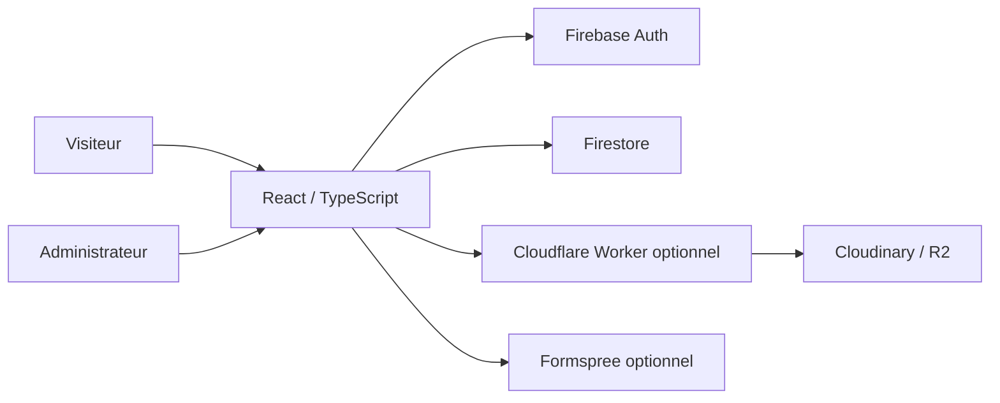

# Moussa Toure — Actor Portfolio & Custom CMS

**Public source-code edition · React 19 · TypeScript · Vite · Firebase Auth / Firestore · Cloudinary / Cloudflare (optional)**

[](https://github.com/carlxwj/moussa-toure-portfolio-code/actions/workflows/checks.yml)

> **English:** A responsive bilingual actor portfolio and customizable CMS. This repository is a **sanitized code-only showcase**, not a copy of the production site or its database. Original photos, PDF CV, real testimonials, media manifests, live contact details and personal project records are **not included**.

**Liens utiles :** [Portfolio en ligne](https://moussatoure-actor.web.app/) · [Tests du code public](https://github.com/carlxwj/moussa-toure-portfolio-code/actions/workflows/checks.yml)

> Le portfolio en ligne utilise des contenus réels distincts des données de démonstration de ce dépôt public. Les médias, le CV et les données de production ne sont pas inclus dans ce code source.

## Présentation

Portfolio professionnel bilingue (français / anglais) réalisé pour un comédien, accompagné d'un système d'administration permettant de publier, modifier, masquer et réorganiser des contenus sans intervenir dans le code. L'objectif de ce dépôt est de **présenter le travail de développement** : architecture React, formulaires, règles d'accès, intégration Firebase et gestion des médias.

**Il ne représente pas une version déployable en production telle quelle.** Les données de démonstration présentes dans `src/content/` sont fictives et explicitement marquées comme telles ; elles ne correspondent à aucun nouveau crédit professionnel réel.

## Fonctionnalités du code

- Interface responsive, navigation fixe, sections réorganisables et transitions visuelles.
- Deux langues : anglais et français, avec textes de navigation et contenus localisés.
- Pages publiques : présentation, projets, expériences/rôles, galeries, shootings, formation, showreel et contact.
- Administration `/admin` protégée par authentification Firebase et autorisations Firestore.
- Gestion des fiches et de l'ordre d'affichage, visibilité des contenus, médias et CV (si configurés).
- Connexion optionnelle à Cloudinary et à un Cloudflare Worker de signature ; stockage R2 optionnel.
- Formspree optionnel pour les demandes de contact ; aucun formulaire réel n'est configuré dans cette édition.
- Règles Firestore, gestion du consentement Analytics et validations d'entrées.

## Architecture



| Répertoire | Rôle |
| --- | --- |
| `src/components/`, `src/pages/` | Interface, navigation, CMS et formulaires |
| `src/lib/` | Firebase, données, internationalisation et médias |
| `src/content/` | **Données fictives / dépersonnalisées** pour la démonstration |
| `firestore.rules` | Contrôle d'accès à la base |
| `cloudinary-worker/` | Passerelle de signature / stockage optionnel |
| `tests/` | Tests indépendants des médias et données de production |
| `docs/` | Documentation technique complémentaire |

## Démarrer localement

Prérequis : Node.js 22+, npm. Par défaut, sans variables Firebase, l'application utilise le jeu de données local de démonstration.

```bash
npm ci
npm run dev
```

Ouvrir `http://localhost:5173`. Pour tester l'administration avec un compte Firebase autorisé, **utiliser son propre projet de test**. Dupliquer `.env.example` en `.env.local` et renseigner des identifiants de test ; ce fichier est ignoré par Git. Les paramètres `VITE_*` sont visibles dans le navigateur : ne jamais y stocker un mot de passe ni une clé serveur.

```bash
npm test
npm run typecheck
npm run build
python3 scripts/scan-secrets.py
```

## Tests et limites

- La copie de production nettoyée avait précédemment passé 84 tests unitaires ; **ce chiffre ne s'applique pas à ce dépôt public distinct**.
- Les tests qui nécessitaient des photos, un CV ou des crédits réels ont été retirés de cette édition. La suite restante comprend **38 tests réussis sur 38** lors du contrôle du 30/10/2026, et se lance avec `npm test`.
- Les tests locaux ne prouvent pas la sécurité de Firebase en production et ne remplacent pas une validation sur Windows/navigateur et avec plusieurs comptes.
- `npm run build` / `npm run typecheck` sont à vérifier après installation des dépendances ; la publication GitHub n'est pas un déploiement.

## Sécurité et confidentialité

- Aucun original photographique, CV, témoignage ou donnée de contact réelle n'est inclus.
- Aucune variable d'environnement privée ni clé serveur ne doit être commitée.
- Les chemins historiques d'images ont été retirés du jeu de données, et les liens vers le CV ne s'affichent pas sans configuration.
- Le dépôt ne contient **pas** l'historique Git du site privé ; il doit être publié comme **nouveau dépôt indépendant**, avec son premier commit propre.
- L'absence de détection de secrets ne constitue pas une garantie de sécurité absolue.

Voir [PUBLICATION_SANS_FUITE.md](PUBLICATION_SANS_FUITE.md), [SECURITY.md](SECURITY.md), et [docs/SECURITE_DONNEES.md](docs/SECURITE_DONNEES.md).

## Droit d'auteur

Le dépôt contient le code de présentation, **pas une licence de redistribution des photographies, du CV, des créations visuelles ou des biographies de tiers**. Ne pas réimporter le dossier privé `public/media/` ou le CV dans le dépôt public sans autorisation appropriée. Pas de licence open source explicite : tous droits réservés par défaut.

## Objectif pédagogique

Développement frontend, TypeScript, conception d'un CMS, authentification, modélisation Firestore, règles de sécurité, confidentialité, déploiement et maintenance. Projet présenté dans le cadre d'un parcours autodidacte vers les études universitaires en informatique.

**Développé par Carlos da Costa.**
